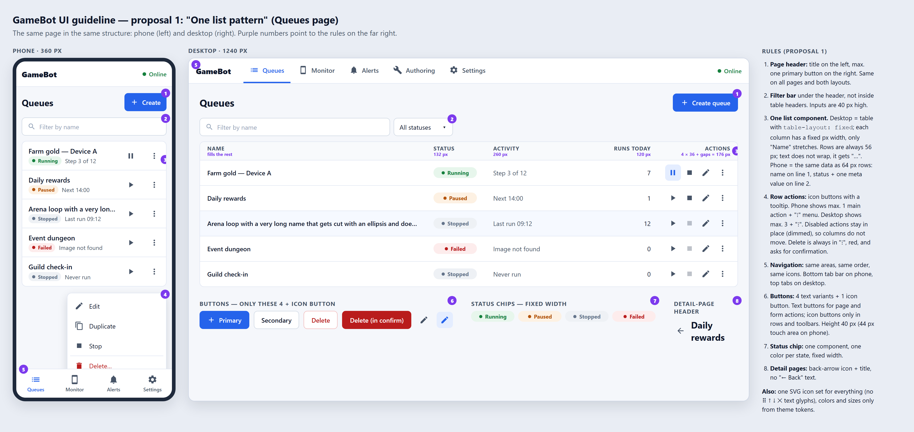

# UI Guidelines

Last reviewed: 2026-11-27

These rules give all pages of the web UI one design, on the phone and on the desktop. The phone layout is the base. The
desktop layout uses the same parts, in the same order, with more space.

This document adds to [mobile-ui-principles.md](mobile-ui-principles.md). Where the two documents do not agree, this
document is correct. Two old rules change:

- Old rule 5 ("Cards, not tables") changes to "one list component" (rule L1). On the phone the list still shows rows that
  look like cards.
- Old rule 11 ("Desktop does not change") does not apply to work that moves a page to these guidelines.

The mockups are in [ui-guidelines/](ui-guidelines/). The HTML sources are in
[ui-guidelines/mockups/](ui-guidelines/mockups/). Open an HTML file in a browser to see or change a mockup.

| Image | Content |
|-------|---------|
| [1-list-pattern.png](ui-guidelines/1-list-pattern.png) | Queues list, buttons, status chips, navigation |
| [2-form-detail-editor-logs.png](ui-guidelines/2-form-detail-editor-logs.png) | Form page, detail page, step editor, Execution Logs |
| [3-settings-images-backup-panel.png](ui-guidelines/3-settings-images-backup-panel.png) | Settings and More, Configuration, Images, Backup & Restore, side panel |

## 1. Tokens

Use only these values. Do not write a color, a size, or a radius directly in a component. Put new values in
`src/theme/tokens.ts` and `src/theme/global.css` first.

| Token | Value | Use |
|-------|-------|-----|
| Font | System font (`Segoe UI`, `system-ui`) | All text. No web font. |
| Text sizes | 12 / 13 / 14 / 15 / 20 / 22 px | Header labels / meta / body / phone row title / phone page title / desktop page title |
| Text input font on phone | 16 px | Stops the iOS zoom on focus. |
| Spacing | 4, 8, 12, 16, 20, 24 px | Gaps and padding |
| Radius | 6 (thumbnail), 8 (button, input), 10 (card, list), 14 (dialog) | |
| Text | `#0f172a`, muted `#475467` | |
| Background | page `#f5f7fb`, surface `#ffffff`, border `#dfe5f2` | |
| Primary | `#2563eb`, soft `#e4edff` | Primary button, active tab, selected item |
| Danger | `#b91c1c`, soft `#fdecec` | Delete, failed |
| Success | `#15803d`, soft `#e7f6ec` | Running, done, on |
| Warning | `#b45309`, soft `#fdf1e3` | Paused, conflicts |
| Idle | `#64748b`, soft `#eef1f5` | Stopped, unknown |
| Block colors | loop `#7c3aed`, if `#0891b2` | Step editor only |

The buttons are flat. They have no gradient and do not move on hover.

## 2. Sizes

| Part | Desktop | Phone |
|------|---------|-------|
| App bar | 56 px | 56 px |
| Text button, input, select | 40 px | 40 px, tap area 44 px |
| Icon button | 36 x 36 px, icon 20 px | 44 x 44 px, icon 20 px |
| List row | 56 px | 64 px (two lines) |
| Step row in the step editor | 56 px | 56 px |
| Menu row, checkbox row | 56 px | 56 px |
| Key-value row | 40 px | 40 px |
| List header row | 40 px | none |
| Status chip | 24 px high, 96 px wide | 20 px high, width from the text |
| Thumbnail in a row | 40 x 40 px | 40 x 40 px |
| Footer bar | 68 px | 68 px |
| Side panel | 480 px wide | full page |
| Form width | max. 720 px, centered | full width |
| Step editor width | max. 880 px, centered | full width |

## 3. Navigation

- **N1. Main areas.** The phone and the desktop show the same areas with the same names, icons, and order:
  Queues, Monitor, Alerts, Authoring (desktop only), Settings (desktop) / More (phone).
- **N2. Phone.** A bottom tab bar with 4 tabs: Queues, Monitor, Alerts, More.
- **N3. Desktop.** Top tabs with an icon and a name, in the app bar.
- **N4. Second level.** On the desktop, sub-tabs go in a second row under the app bar.
  - Authoring: Commands, Games, Sequences, Images, Backup & Restore.
  - Settings: Execution logs, Configuration, Gamepacks, Update.
- **N5. More.** On the phone, More is a list of menu rows with the same items as the Settings sub-tabs. A menu row has an
  icon, a name, one optional status line, and a chevron. Desktop-only areas show as dimmed rows with the text
  "Use a computer".
- **N6. Detail pages.** The header has a back-arrow icon button and the title. Do not use the text "← Back".
- **N7. Connection.** The app bar shows the connection state ("Online", or the connection-lost banner).

## 4. Page header

- **H1.** The title is on the left. One primary button can be on the right. Other page actions are secondary buttons or
  go in a "⋮" menu.
- **H2.** A detail page header has: back arrow, title, status chip (if the item has a state).
- **H3.** The filter bar goes under the header. Filters are never inside a table header.

## 5. Buttons and icons

- **B1. Five button types only:**
  - Primary: blue fill. Max. one on a screen.
  - Secondary: white with a grey border.
  - Danger outline: white with red text. For Delete on a page or in a form.
  - Danger: red fill. Only for the action button in a confirmation dialog.
  - Icon button: no border, muted icon, soft blue background on hover. Red icon for Delete.
- **B2. Where to use text and where to use icons.** Use text buttons for page, form, and dialog actions. Use icon
  buttons only in rows and in toolbars. Each icon button has a tooltip and an `aria-label`.
- **B3. One icon set.** All icons are inline SVG from one set (Material style, 24 px view box) in one shared module. Do
  not use text glyphs such as ⠿ ↑ ↓ ✕ ✓ ▶ ▾ ▸ ⋯ ☰ as icons.
- **B4. One icon for one action.** The same action has the same icon on all pages: play, pause, stop, edit (pencil),
  duplicate, delete (bin), more (⋮), back (arrow), close (✕ as SVG), drag handle, expand (chevron), upload, download,
  search, filter, add (+).
- **B5. Delete.** Delete is red and always asks for confirmation (rule D1). In a row, Delete is always in the "⋮" menu.

## 6. Lists and tables

- **L1. One list component.** All lists use one shared component. On the desktop it shows a table. On the phone it
  shows rows.
- **L2. Fixed columns.** The desktop table uses `table-layout: fixed`. Each column has a fixed width in px. Only one
  column (normally the name) gets the remaining width. The columns do not change width when the data changes.
- **L3. Fixed rows.** All rows have the same height (see section 2). Text in a row does not wrap. Long text ends with
  "…". The full text shows in the tooltip and on the detail page.
- **L4. Phone rows.** Line 1: the name. Line 2: the status chip and one meta value. On the right: max. one main
  action icon and the "⋮" menu.
- **L5. Row actions.** Desktop: max. 3 icon buttons and the "⋮" menu. Phone: max. 1 icon button and the "⋮" menu. The
  actions column has a fixed width: (number of icons x 36 px) + gaps.
- **L6. Actions do not move.** An action that is not available now stays in its position and is dimmed. It does not
  go away. So the other icons do not move.
- **L7. Row click.** A click or a tap on the row (not on an action) opens the item: the detail page or the edit page.
  The name is not a separate link.
- **L8. Empty values.** An empty cell shows "—". It is not blank.
- **L9. Numbers and times.** Numbers align on the right and use tabular digits. Times and technical values (paths, IDs)
  use a monospace font.
- **L10. Thumbnails.** An image shows as a 40 x 40 px thumbnail in the row. There is no grid view.
- **L11. Expandable rows.** The expand chevron is an icon button in a fixed 48 px first column. The expanded panel is
  a full-width row under the row. It can have any height. The normal rows keep their height.
- **L12. Big lists.** Paging at the bottom with 25 rows on each page. No endless scroll.
- **L13. Filters.** Filters are chips (on or off) on the phone and on the desktop. On the phone a filter icon in the
  header opens all filters as a form page.
- **L14. States.** Loading, empty, and error states have one design for all lists, with the same text: "Loading…",
  "No items.", and the error text with a **Try again** button.

## 7. Status chips

- **S1.** One status chip component for all states. Each state has one color (see section 1) and a dot.
- **S2.** On the desktop the chip has a fixed width (96 px), so the column does not change.
- **S3.** The text of the chip is one word: Running, Paused, Stopped, Failed, Done, On, Off.

## 8. Forms

- **F1.** The label is above the field. Never at the side.
- **F2.** Fields are in cards. Each card has a heading. The cards and the fields have the same order on the phone and
  on the desktop.
- **F3.** On the desktop the form is max. 720 px wide and centered. Use max. 2 columns, and only for short fields.
- **F4. Footer bar.** A footer bar at the bottom of the screen is always visible. Delete (danger outline, only in edit
  mode) is on the left. Cancel and Save are on the right. Save is always the last button. A short summary text can be
  on the left (for example "Changes are not saved").
- **F5. Errors.** A field with an error has a red border and the error text under it. Do not use a pop-up.
- **F6. Choices.** On/off values use a toggle. A choice of 2 to 4 values uses a segmented control. More values use a
  select.
- **F7. Two modes on one page** (for example Backup and Restore) use a segmented control at the top of the page.
- **F8. Checkbox lists** use 56 px rows. The first row is "Select all" with a count.

## 9. Detail pages

- **P1.** The header follows rule H2.
- **P2. Actions.** On the desktop the main actions are text buttons in the header, with "⋮" for other actions. On the
  phone the same main actions (max. 2) are in the footer bar, and the other actions are in "⋮" in the app bar.
- **P3.** Key-value data is in a card. The label (muted) is on the left. The value is on the right.
- **P4.** A list in a detail page uses the list component.
- **P5.** On the desktop use max. 2 columns. On the phone use 1 column with the same order.

## 10. Step editor

- **E1.** Each step is one 56 px row: drag handle, number (desktop), type icon, title and one detail line, actions.
- **E2.** The type icon has a colored background: blue for an action, purple for a loop, teal for an if.
- **E3.** A loop or an if is a block with a 4 px colored left border. Its child steps are indented by 28 px. The last
  row of the block is "Add step to …".
- **E4. Reorder.** Drag on the phone and on the desktop. "Move up" and "Move down" are in the "⋮" menu for keyboard and
  touch use. There are no ↑ or ↓ buttons in the row.
- **E5. Row actions.** Desktop: Edit, Duplicate, and "⋮". Phone: "⋮" only.
- **E6. Edit a step.** On the desktop a side panel opens (rule D2). On the phone a form page opens.

## 11. Dialogs and panels

- **D1. Confirmation dialog.** One design for all confirmations. The title is a question with the number of items
  ("Delete 3 queues?", "Restore 209 items?"). One sentence tells the effect. The buttons are Cancel and the action. The
  action is red (danger) when it deletes or replaces data.
- **D2. Side panel.** On the desktop, the edit form for one item of a list opens in a 480 px side panel on the right.
  The list stays visible. The edited row has a light blue background and a 3 px blue line on the left. The panel has a
  header (title and close icon), the form, and its own footer with Cancel and Apply. **Apply** changes the item in the
  list. **Save** in the page footer saves the page. On the phone the same form is a full page.

## 12. Checklist (pass or fail)

Use this list together with the [phone checklist](mobile-ui-principles.md#checklist-pass-or-fail).

- [ ] The page uses only the tokens of section 1. No direct colors or sizes.
- [ ] The page header follows H1 to H3.
- [ ] Each list uses the shared list component, with fixed column widths and fixed row heights.
- [ ] The columns do not change width when the data changes, a row expands, or an action turns off.
- [ ] Row actions are icon buttons with a tooltip. Max. 3 on the desktop, 1 on the phone, and "⋮".
- [ ] Delete is red, is in "⋮" in rows, and asks for confirmation with the shared dialog.
- [ ] All icons come from the shared icon set. No text glyphs as icons.
- [ ] The form uses labels above the fields, cards, and the footer bar.
- [ ] The phone and the desktop show the same parts in the same order.
- [ ] All new text is STE.

## 13. Shared components

The shared components are in `src/web-ui/src/components/ui/`. Import them from `components/ui`. Each component uses
only the tokens of section 1, and each hover rule is inside `@media (hover: hover)`.

- **Icon, icons.ts**: the one icon set. Rule: all icons come from the shared icon set (checklist).
- **Button**: variants `primary`, `secondary`, `danger-outline`, and `danger`. 40 px high. Rule: the red color
  is for danger only (section 11, D1).
- **IconButton**: an icon with a required accessible name and a tooltip. 36 px, and 44 px on the phone. Rule: row
  actions are icon buttons with a tooltip.
- **PageHeader**: the title, an optional back button, an optional status chip, and the page actions (rules H1 to H3).
- **StatusChip**: a dot and one word, with the same size and colors on all pages.
- **ListView**: the list component. A table with fixed column widths and 56 px rows on the desktop, and two-line rows
  of 64 px on the phone. Rule: the columns do not change width when the data changes.
- **RowActionMenu**: the "more" menu of a row. A danger item is last and is red. Rule: Delete is in the menu of a row.
- **FooterBar**: the bar at the bottom of a form page (section 9). It has no user yet.
- **ConfirmDialog**: the one confirmation dialog (rule D1). The focus starts on Cancel.

The old `components/queues/IconButton.tsx` and `features/execution/StatusChip.tsx` are wrappers or old components
until all pages move to the shared components.